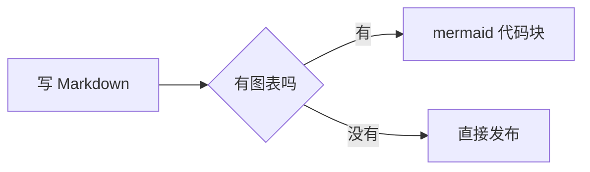

除了标准 Markdown，这个主题还接了一些扩展能力，写技术文章时挺方便。

## 提示框

用 GitHub 风格的引用语法，第一行写上类型即可：

```markdown
> [!NOTE]
> 补充说明，读不读都不影响主线。
```

> [!NOTE]
> 补充说明，读不读都不影响主线。

支持 `NOTE`、`TIP`、`IMPORTANT`、`WARNING`、`CAUTION` 五种：

> [!WARNING]
> 破坏性操作前记得备份。

> [!CAUTION]
> 这条最重，一般用来提醒「会丢数据」的事。

也可以用指令写法（效果一样）：

```markdown
:::tip
另一种写法。
:::
```

:::tip
另一种写法。
:::

## 代码块

代码块用三个反引号包起来，第一行跟上语言名。高亮由 Expressive Code 接管，配色是 Catppuccin Latte（浅色）/ Mocha（深色），跟随站点主题切换。

最基础的写法：

````markdown
```ts
export function greet(name: string) {
  return `你好，${name}`
}
```
````

```ts
export function greet(name: string) {
  return `你好，${name}`
}
```

### 标题

在语言名后面写 `title="..."`，代码块上方会出现一条标题栏：

````markdown
```ts title="greet.ts"
export function greet(name: string) {
  return `你好，${name}`
}
```
````

```ts title="greet.ts"
export function greet(name: string) {
  return `你好，${name}`
}
```

### 行号

加 `showLineNumbers` 就会显示行号：

````markdown
```ts showLineNumbers
export function greet(name: string) {
  return `你好，${name}`
}
```
````

```ts showLineNumbers
export function greet(name: string) {
  return `你好，${name}`
}
```

### 高亮指定行

用 `ins={行号}`（或 `{起-止}`）标出重点行，`del` 则是删除标记：

````markdown
```ts showLineNumbers ins={2}
export function greet(name: string) {
  return `你好，${name}`
}
```
````

```ts showLineNumbers ins={2}
export function greet(name: string) {
  return `你好，${name}`
}
```

### 折叠

长代码块可以用 `collapse` 折叠成「展开」栏：

````markdown
```ts collapse={2-4}
export function greet(name: string) {
  const prefix = '你好，'
  const suffix = '！'
  return prefix + name + suffix
}
```
````

```ts collapse={2-4}
export function greet(name: string) {
  const prefix = '你好，'
  const suffix = '！'
  return prefix + name + suffix
}
```

代码块右上角还有复制按钮，点一下整段代码进剪贴板。

## 图表



用 `mermaid` 作为代码块的语言名，整段内容就会被渲染成图，具体写法见[流程图、时序图与甘特图](/posts/mermaid-guide/)。

## 数学公式

行内公式用 `$...$`，块级公式用 `$$...$$`，由 KaTeX 渲染：

质能方程 $E = mc^2$，以及一个块级式子：

$$
\int_{-\infty}^{\infty} e^{-x^2}\,\mathrm{d}x = \sqrt{\pi}
$$

写机器学习或算法笔记时，这个支持能省掉截图公式的麻烦。

## 折叠内容

`<details>` 原生标签也能用：

<details>
<summary>点开看一段被折叠的内容</summary>

折叠区里可以放任意 Markdown，包括代码和公式。

</details>

## 小结

- 提示框：`> [!TYPE]` 或 `:::type`
- 代码块：Expressive Code（标题 `title`、行号 `showLineNumbers`、高亮 `{2}`、折叠 `collapse`、复制按钮）
- 图表：`mermaid` 代码块
- 公式：`$...$` 与 `$$...$$`
- 其它：原生 HTML 标签基本都能用

够用了，剩下的交给内容。
