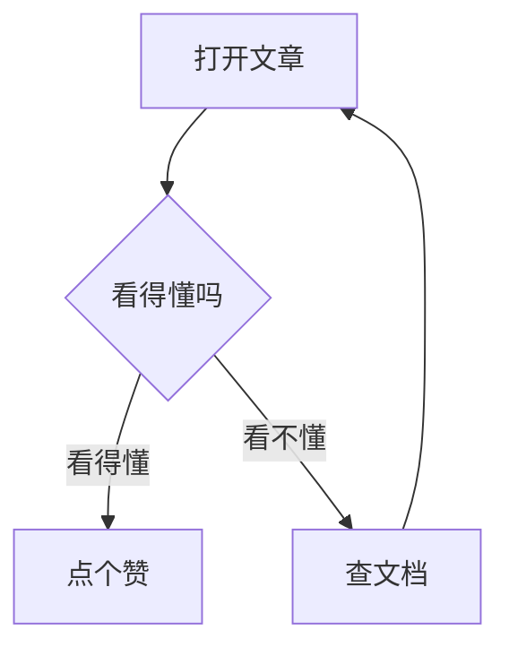
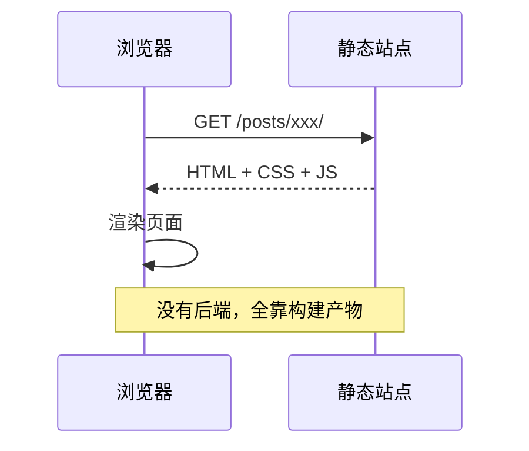
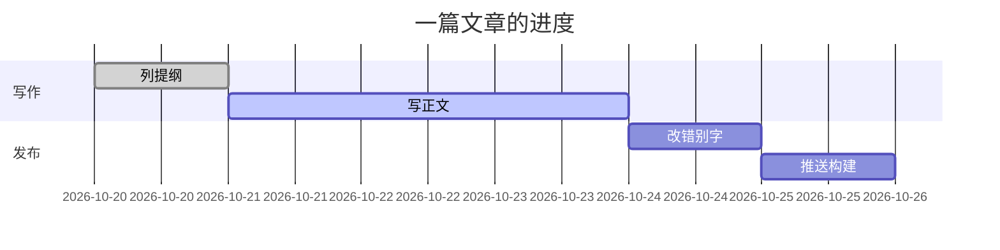
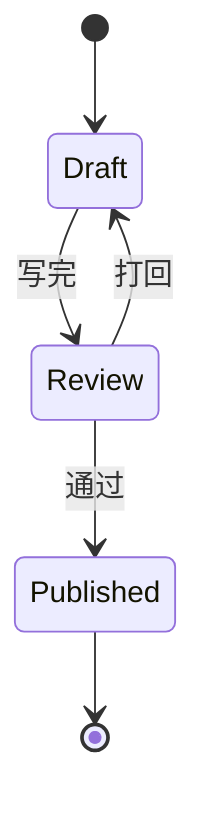
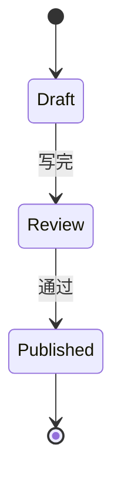

写架构、写流程、写排期，最烦的是画完图还要导出一张 png 再传上来，图一改就得重来一遍。

本站接了 [Mermaid](https://mermaid.js.org/)，直接在代码块里写图，构建时渲染成 SVG——图就是文本，改起来和改错别字一样快。

## 流程图

````markdown

````


`flowchart` 后面的 `TD` 是方向：`TD` 从上到下、`LR` 从左到右、`BT`、`RL` 同理。

## 时序图

````markdown

````


## 甘特图

````markdown

````


## 状态图

````markdown

````



## 几个实用细节

- **主题会自动跟随**：页面切到深色，图也跟着换深色主题，不用手动配两套。
- **无刷新换页也能画**：本站用 swup 做页面过渡，换页后新出现的图会自动补渲染。
- **写错了会显示错误框**：语法不对时，图的位置会显示 `Error rendering diagram` 和具体报错，照着改就行，不会静默消失。
- **图是文本**：可以直接被搜索、被复制、被 diff，比截图友好太多。

## 小结

| 类型 | 关键字 |
| --- | --- |
| 流程图 | `flowchart TD` / `LR` |
| 时序图 | `sequenceDiagram` |
| 甘特图 | `gantt` |
| 状态图 | `stateDiagram-v2` |
| 类图 | `classDiagram` |

更多图类型看 [Mermaid 官方文档](https://mermaid.js.org/intro/)。
